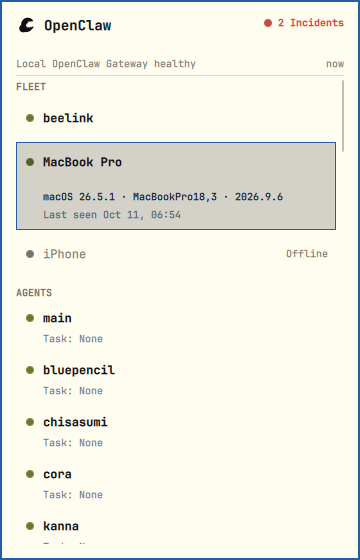
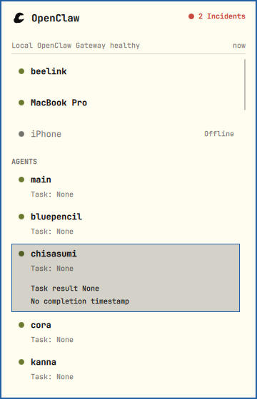
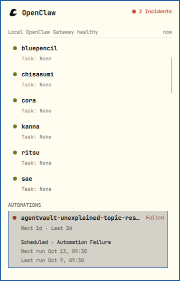

# Clawbar

**See the state of OpenClaw without leaving your Omarchy bar.**

Clawbar is a read-only status surface for your Gateway, Fleet, registered
Agents, and Automations. The bar shows whether anything needs attention; the
keyboard-first panel explains what changed without exposing task content,
messages, credentials, or raw errors.



The screenshots below show version 0.1.1 in the real Omarchy shell, using live
OpenClaw metadata rather than developer demo data. Names, states, and times
reflect that installation, not a bundled example.

## Install

```sh
omarchy plugin add https://github.com/yasuhito/clawbar.git --enable
```

Clawbar appears in the right bar section and starts collecting immediately. It
uses the Gateway already resolved by OpenClaw, so a normal local or configured
remote setup needs no second connection configuration.

## What you get

- **One-glance status.** The Claw changes color with current severity; open the
  panel for Gateway status, Fleet devices (Nodes), registered Agents, previous
  Task Results, and Automations. The header shows the current Incident count.
- **Quiet incident notifications.** Clawbar groups failures and recoveries and
  does not repeat the same notification on every refresh.
- **A responsive shell.** Collection runs outside QML, has a 25-second deadline,
  and renders from an atomic cached snapshot without blocking Quickshell.
- **A strict privacy boundary.** Only bounded Operational Metadata reaches the
  panel. Clawbar never stores a Gateway token or displays Private Content.
- **Keyboard-first operation.** Navigate with arrows or `j`/`k`, refresh with
  `r`, and close with Escape.

## Requirements

- Omarchy with the Quickshell plugin commands (`omarchy plugin ...`)
- OpenClaw `2026.7.1-2` or a later stable release with the same supported JSON
  command surfaces (also verified with `2026.9.9`)
- Python 3; the collector uses only the standard library
- Optional: Tailscale for the verified fallback setup when OpenClaw cannot
  resolve a local, configured remote, or Node-host Gateway

Clawbar does not install a Python package, daemon, systemd service, or timer.
One Quickshell service entry point owns the bounded collection schedule. It
collects immediately after enablement and repeats every 30 seconds. OpenClaw
first resolves its normal local or configured remote Gateway. If that fails on
a Node host, Clawbar uses the Gateway connection recorded in OpenClaw-owned
Node-host state; it never probes Fleet Nodes directly and never stores a
Gateway token.
If the Gateway retains several registrations with the same Node display name,
Clawbar shows only the freshest connected registration.

If none of those sources resolves a Gateway, the panel shows Gateway Setup
Required and lists online Tailscale devices under stable, opaque candidate
keys. Select a device with `j`/`k` or the arrow keys and press Enter. Clawbar
accepts it only after the bounded, read-only Gateway JSON probe succeeds. A
verified target is reused for later collections; Clawbar never asks for or
stores a Gateway token or password.
Without Tailscale, the panel stays in the non-Incident setup state and gives
instructions to connect Tailscale and refresh.

## Configure

Set `CLAWBAR_REFRESH_INTERVAL_SECONDS` before starting Omarchy Shell to change
the interval. Accepted values are 15 through 300 seconds.

```sh
export CLAWBAR_REFRESH_INTERVAL_SECONDS=60
omarchy restart shell
```

The whole collection has a 25-second deadline, allowing for OpenClaw CLI startup
costs. Independent metadata calls run concurrently against the same Gateway,
while target resolution and each Automation page sequence remain ordered. A slow or unavailable Gateway
cannot accumulate overlapping collector processes or block the bar. A healthy
snapshot becomes Stale after three configured refresh intervals.
Each command output stream and local state file is limited to 8 MiB. Clawbar
reads state only from regular files without following a final symbolic link,
so a replaced FIFO, device, link, or oversized file cannot block collection or
the bar cache reader.

## Use

Press Clawbar to open the panel.

- `j`, `k`, Up, Down: move selection
- Enter: verify the selected Gateway candidate
- `r`: request a non-blocking refresh
- Escape: close the panel
- Middle-click the bar widget: request a non-blocking refresh

The bar icon changes color with current severity and briefly snaps while
hovered or collecting; its compact slot does not render a separate status dot
or count. The tooltip reports current Attention Items while yellow or red. The
panel keeps Gateway identity and status pinned while its operational rows
scroll. Selecting a Node, Agent, or Automation expands its bounded Operational
Metadata directly beneath that row; selecting another row moves the single
expanded detail with the selection. The panel keeps Agents and Automations in
independent sections because Gateway metadata establishes no Node ownership; an
empty Agents section is omitted. Routine healthy Node and Automation rows omit
the repeated `Healthy` label while retaining it for accessibility; exceptional
and historical states remain explicit. The pinned header shows Gateway status or
current Incident severity. Registered Agents use a static green presence dot
without claiming health or current activity; previous Task Result remains
separate. On releases that have removed the Tasks ledger, registered Agents
remain visible with Task Result `None`; Clawbar does not infer results from
session content. Offline Nodes appear as muted Operational Metadata and do not
affect Attention counts, Incidents, or notifications. Automation Failures appear
once in the Automations section. The header can show a healthy Gateway alongside
Incidents from failed Automations; an Incident count is not a Gateway health
label.

### Row details in 0.1.1

A selected device shows available platform, model, version, and last-seen
metadata. Agent details show the previous Task Result and completion timestamp
when available. Automation details show schedule kind, result, next run, and
last run. Details expand below the selected row's summary without overlapping
it, and keep the same text alignment as the row. Selecting a different row
closes the previous detail.

| Registered Agent | Failed Automation |
| --- | --- |
|  |  |

These live Agents report `Task: None` because this OpenClaw release has no Tasks
ledger. Their green presence dots mean registered, not running or healthy. The
failed Automation still contributes to Incidents while the Gateway is healthy.

## Privacy boundary

Clawbar persists only Operational Metadata: generalized health states, bounded
Node and Agent display names, model/runtime labels, Automation schedule
metadata, timestamps, and opaque local UI keys. It discards raw command output
after parsing.

Clawbar never persists or displays task instructions, message bodies,
destinations, account identifiers, credentials, private Node or Tailscale
identifiers, or raw errors in the public snapshot. Bounded device display names
may be visible; Gateway endpoints and addresses are not shown in the panel.
Tailscale device identifiers are HMACed with Clawbar's local secret into stable
candidate keys before entering a
snapshot. QML does not open user-controlled files directly. It obtains both the
snapshot and current theme colors through collector commands that cap each read
at 8 MiB, accept regular files only, and do not follow a final symbolic link.
The snapshot is `$XDG_STATE_HOME/clawbar/snapshot.json` (or
`~/.local/state/clawbar/snapshot.json`). Private mode-`0600` state beside the
snapshot maps opaque candidate keys to Tailscale targets and remembers a
verified Tailscale fallback. Automatic resolution never replaces that fallback.
The private target-state files can contain endpoint URLs needed to reach the
verified fallback, but none contains a token, password, or other credential.
Incident deduplication state and the local key secret are per-login data under
`XDG_RUNTIME_DIR`.

Selecting an Automation reveals only its bounded Operational Metadata.
Clawbar cannot create, edit, retry, cancel, enable, disable, or delete OpenClaw
work.

## Update, disable, and remove

```sh
omarchy plugin update io.github.yasuhito.clawbar --yes
```

The update command does not restart Omarchy Shell. If the old version stays
loaded after updating, reload it with:

```sh
omarchy restart shell
```

To stop collecting or uninstall:

```sh
omarchy plugin disable io.github.yasuhito.clawbar
omarchy plugin remove io.github.yasuhito.clawbar --yes
```

Disable and remove unload the Quickshell service immediately, stopping future
collection and notification scheduling. A collector already inside its bounded
request exits within 25 seconds. No systemd unit, timer, or background daemon is
left behind.

## Developer demonstration

`scripts/clawbar_demo.py` pauses Gateway collection for the desktop login and
writes fictional, sanitized snapshots through the same atomic snapshot seam
used by the collector. The panel labels these snapshots `Developer demo` so
they cannot be mistaken for current Gateway data. This is a development tool,
not a user-facing mode. Run a scenario, open the actual Omarchy panel, and
repeat for all twelve accepted states:

```sh
python scripts/clawbar_demo.py setup-required
python scripts/clawbar_demo.py healthy
python scripts/clawbar_demo.py registered-agents
python scripts/clawbar_demo.py unstable-gateway
python scripts/clawbar_demo.py offline-gateway
python scripts/clawbar_demo.py degraded-gateway
python scripts/clawbar_demo.py configuration-error
python scripts/clawbar_demo.py automation-failure
python scripts/clawbar_demo.py stale-snapshot
python scripts/clawbar_demo.py empty-fleet
python scripts/clawbar_demo.py grouped-incidents
python scripts/clawbar_demo.py recovery
```

Resume normal scheduled collection after review:

```sh
python scripts/clawbar_demo.py --resume
```

`grouped-incidents` shows two Offline Nodes as muted Operational Metadata and
starts one grouped notification for two Automation Failures. `recovery`
restores a healthy Fleet and emits one grouped recovery notification. Use
`j`/`k` and Enter while reviewing the panel.

For release review, exercise each scenario in the actual shell at narrow and
wide panel widths on `white`, `catppuccin-latte`, `flexoki-light`, and
`vantablack`, then repeat once with reduced motion. Confirm immediate panel
navigation while a delayed collector runs and check the shell console for QML
errors.

## Marketplace

- Category: `Widgets`
- Tags: `ai`, `bar`, `quickshell`
- License: MIT
